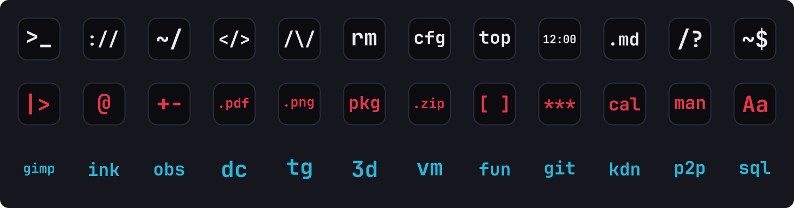

<div align="center">

# ASCII icons

Monospace text icon theme for Linux.



</div>

## Icons

| Glyph   | Application         |
| ------- | ------------------- |
| `>_`    | Terminal            |
| `://`   | Web browser         |
| `~/`    | File manager        |
| `</>`   | Code editor         |
| `/\/`   | Music player        |
| `rm`    | Trash               |
| `cfg`   | Settings            |
| `top`   | System monitor      |
| `12:00` | Clock               |
| `.md`   | Text editor         |
| `/?`    | Search, app finder  |
| `~$`    | Application menu    |

Icons not covered by the theme are inherited from Papirus-Dark.

## Installation

```sh
git clone https://github.com/joagvv/ascii-icons.git
cd ascii-icons
./install.sh
```

The theme is installed to `~/.local/share/icons/ASCII` and applied automatically on XFCE.
On other desktops, select **ASCII** in the appearance settings, or on GNOME:

```sh
gsettings set org.gnome.desktop.interface icon-theme ASCII
```

Running `./install.sh` again replaces the previous install, so it's also how you change colors.
`./install.sh --uninstall` removes the theme and switches XFCE back to the icon theme that was active before.

### Dependencies

- bash 4+
- `papirus-icon-theme` (recommended, used for every icon this theme doesn't draw)
- `gtk-update-icon-cache` (optional)

## Usage

```
./install.sh [text] [tile] [border]
```

Each argument accepts a preset, a hex color or `none`.

| Command                               | Result                        |
| ------------------------------------- | ----------------------------- |
| `./install.sh`                        | White text on a dark tile     |
| `./install.sh red`                    | Preset text color             |
| `./install.sh "#ff8800"`              | Custom text color             |
| `./install.sh red "#000000" "#333344"`| Custom text, tile and border  |
| `./install.sh cyan none none`         | Text only, no tile            |
| `./install.sh --uninstall`            | Remove the theme              |

Presets: `white`, `red`, `magenta`, `cyan`, `yellow`, `green`, `gray`, `black`.

## Building

`install.sh` and `assets/preview.svg` are generated from `src/`. Don't edit them directly.

```sh
make          # rebuild install.sh and the preview
make check    # bash -n and shellcheck
tests/install.sh
```

Glyph outlines in `src/paths.json` only need regenerating when an icon's text changes.
That step needs the font and fonttools:

```sh
pip install fonttools brotli
cp /path/to/JetBrainsMono-Bold.woff2 src/
make paths && make
```

| File                     | Purpose                                         |
| ------------------------ | ----------------------------------------------- |
| `src/icons.py`           | Icon text, context and the icon names it covers |
| `src/generate_paths.py`  | Converts icon text into SVG paths               |
| `src/paths.json`         | Generated SVG paths                             |
| `src/build_installer.py` | Fills the template with paths and names         |
| `src/install.sh.in`      | Installer template                              |
| `src/build_preview.py`   | Draws `assets/preview.svg`                      |

### Adding an app

Find the icon name the app asks for (the `Icon=` line in its `.desktop` file),
add it to the matching entry in `src/icons.py` and run `make`.

## Credits

- [JetBrains Mono](https://github.com/JetBrains/JetBrainsMono), SIL Open Font License 1.1
- [Papirus](https://github.com/PapirusDevelopmentTeam/papirus-icon-theme), GPL-3.0

## License

[MIT](LICENSE)
